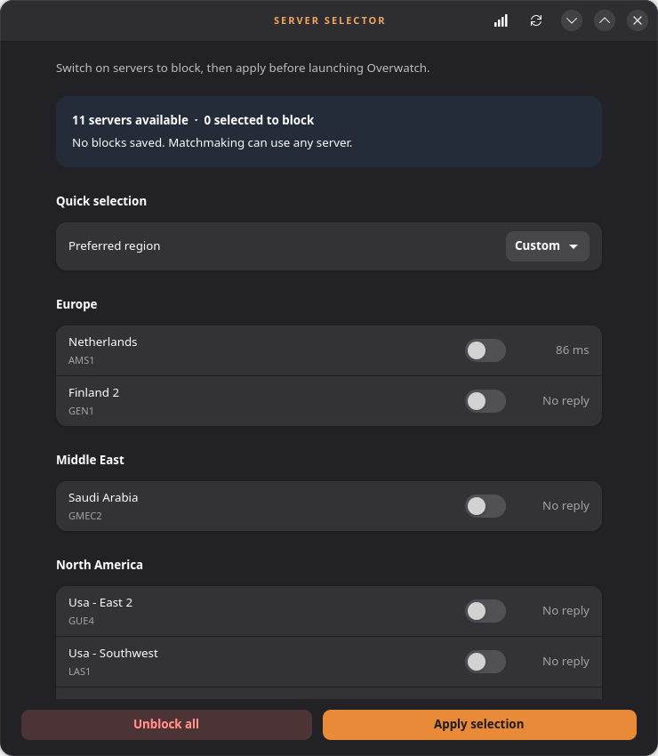

# Overwatch Server Selector for Linux

A native Linux app to avoid selected Overwatch servers. Choose a region or individual servers, check their ping, and keep your blocks updated automatically.

  

## Get started

1. Download the AppImage from [GitHub Releases](https://github.com/Kvendy-an/overwatch-server-selector-for-linux/releases), mark it executable, and open it.
2. Click **Enable firewall control** if prompted.
3. Choose the servers to **block**, click **Apply selection**, and authenticate before launching Overwatch. Leave at least one server available.

Click the **signal-bars icon** to refresh ping. To remove your blocks, click **Unblock all**.

Requires x86_64 Linux with glibc 2.39+, systemd, nftables, PolicyKit, and Python 3.10+. The AppImage bundles the GUI runtime. Ping readings require the host `ping` command.

Blocks persist after closing the app and affect all apps on your account using those IP ranges. A preferred server is not guaranteed. If a match cannot connect, use **Unblock all**. Ping readings may differ from in-game latency.

## More information

- [AppImage setup, troubleshooting, and builds](RELEASE.md)
- [Source installation, CLI, recovery, and development](docs/guide.md)
- [What's new in v0.2.0](docs/releases/v0.2.0.md)

Uses [Dropship's server data](https://github.com/stowmyy/dropship). Licensed under [GPL-3.0](LICENSE). Independent project, unaffiliated with Dropship, MINA, or Blizzard.

This repository and app icon are generated by **ChatGPT Sol 6.1**. AppImage release was tested on **Fedora 44**.
