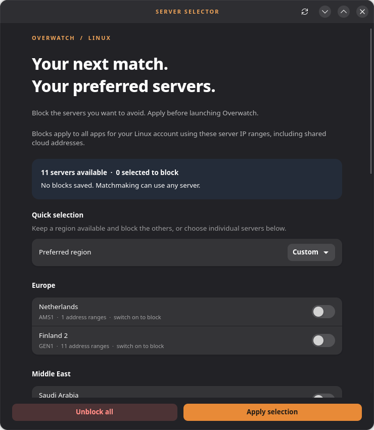

# Overwatch Server Selector for Linux

A native GTK 4 / libadwaita desktop app for avoiding selected Overwatch servers on Linux. Choose individual servers or keep a preferred region available, then apply the selection before starting the game.

The app uses the same maintained [server feed as Dropship](https://stowmyy.github.io/dropship/ips.json). An installed systemd timer refreshes applied blocks every hour, including when the app is closed, and restores them after reboot. Failed updates retain the last working list. An offline starter snapshot is included.

This is an independent Linux application, unaffiliated with Dropship, MINA, or Blizzard.

<p align="center">
  
</p>

<p align="center">
  
</p>

## AppImage release

The portable AppImage is available in the [releases](https://github.com/Kvendy-an/overwatch-server-selector-for-linux/releases). It bundles the desktop runtime for systems with glibc 2.39+; no separate GTK or Python installation is needed to open the GUI. Mark it executable and double-click it, then choose **Enable firewall control** to install the helper and automatic-update timer. The host still needs nftables, PolicyKit, systemd, and Python 3.10+ for the privileged helper.

See [RELEASE.md](RELEASE.md) for launch instructions, compatibility, checksums, FUSE fallback, and the AppImage build recipe. The release page also provides the matching source archive; building from source writes artifacts under `dist/`.

## Try the interface

From this directory, as your normal desktop user:

```bash
python3 -m owselector --preview
```

Preview mode disables firewall changes and network downloads. You can explore region presets, individual switches, and the automatic-update option before installing anything.

## Install

Requires Python 3.10+, GTK 4, libadwaita 1.4+, PyGObject, nftables, PolicyKit (`pkexec`), and systemd. Use your distribution's system Python; a virtual environment normally cannot see distribution-provided PyGObject.

Fedora:

```bash
sudo dnf install python3 python3-gobject gtk4 libadwaita nftables polkit
```

Ubuntu 24.04+ / Debian 13+:

```bash
sudo apt install python3 python3-gi gir1.2-gtk-4.0 gir1.2-adw-1 nftables pkexec
```

Arch Linux:

```bash
sudo pacman -S python python-gobject gtk4 libadwaita nftables polkit
```

Then, from this project directory:

```bash
sudo ./install.sh
```

Open **Overwatch Server Selector** from your app menu, or run `ow-server-selector`. Run the desktop app as your regular user. Applying a selection opens the system administrator authentication prompt. The installer creates no blocks until you apply a selection.

Installation copies the app to `/usr/local/lib/ow-server-selector`, installs a small root helper under `/usr/local/libexec`, adds a desktop launcher, and enables `ow-server-selector.timer`. The desktop app stays unprivileged. Root-owned helper code runs through isolated Python and accepts server IDs and one update preference rather than arbitrary nftables commands.

## Use

1. Close Overwatch.
2. Choose a preferred region, or switch on each server you want to **block**. A switch that is off means that server remains available.
3. Leave at least one server unblocked.
4. Keep **Automatic updates** enabled to refresh applied blocks hourly. A changed preference takes effect when you apply it.
5. Click **Apply selection** and authenticate. Then launch Overwatch through Steam/Proton or Wine.

Blocks remain when the app closes. To stop blocking, click **Unblock all** and authenticate. This action works even when the saved server feed is damaged or the internet is unavailable. A successful application reports the saved selection; the UI does not independently verify live firewall state after external firewall changes.

The toolbar refresh button downloads the server list for the interface. The privileged helper also independently downloads the official feed when applying a nonempty selection, falling back to its last good copy if offline. The timer downloads and reapplies saved selections without interactive authentication. If automatic updates are disabled, the timer restores the saved list without downloading a new one.

## Scope and limitations

- Rules match **your Linux account's outbound traffic to the selected IP ranges**, across all protocols and applications. They are not scoped to the Overwatch executable. Cloud ranges can host unrelated services, so other apps connecting to those addresses may also be affected. Other Linux user accounts are unaffected.
- The implementation supports IPv4 and IPv6 and operates only on the `inet ow_server_selector` nftables table. It never flushes the system ruleset. nftables checks the generated rules and commits replacement as one transaction.
- Server avoidance can influence matchmaking, but it cannot guarantee placement in a region. Apply before launching the game. If a match cannot connect, unblock immediately. Party members may also need the same avoidance preferences; the practice range is not a reliable matchmaking test. See [Dropship's usage notes](https://github.com/stowmyy/dropship).
- Server ranges are maintained by a community project and can become outdated. Newly added servers start unblocked. If a selected ID disappears, the refresh retains the prior working list and records an error rather than silently dropping the selection. Use **Unblock all**, refresh, then choose again.
- Hourly updates can change blocked ranges during play. Disable automatic updates and apply the preference if you need a fixed list during a session.
- Blocks are restored shortly after boot, once the timer fires and the service can run. A firewall manager reload that deletes third-party tables can remove blocks until the next refresh. The app does not alter firewalld, UFW, or system nftables configuration files.
- One saved selection/account is supported per computer. Another account cannot replace an existing blocked selection. An administrator can use the emergency helper to clear it.
- This is a source installation for a desktop with systemd and host nftables access. Flatpak-only installation and immutable system layouts need separate packaging.

## CLI and recovery

Before installing, replace `ow-server-selector` below with `python3 -m owselector`.

```bash
ow-server-selector list
ow-server-selector preview gmec2            # Print rules without applying them
ow-server-selector block gmec2              # Avoid Saudi Arabia
ow-server-selector block gmec2 --no-auto-update
ow-server-selector unblock
ow-server-selector status                   # Read saved state, without authentication
ow-server-selector update                   # Refresh the interface's cached list
```

Check the timer and update logs:

```bash
systemctl status ow-server-selector.timer
journalctl -u ow-server-selector.service
```

Administrators can force an update, inspect live table presence, or unblock without the desktop app:

```bash
sudo /usr/local/libexec/ow-server-selector-helper refresh
sudo /usr/local/libexec/ow-server-selector-helper status
sudo /usr/local/libexec/ow-server-selector-helper disable
```

The saved selection, last good list, timestamps, and any refresh error are under `/var/lib/ow-server-selector`. The GUI download cache is under `$XDG_CACHE_HOME/ow-server-selector` or `~/.cache/ow-server-selector`. Do not edit the privileged helper or root state through user-owned symlinks.

## Uninstall

```bash
sudo ./uninstall.sh
```

The uninstaller stops the timer/service, removes server blocks, and removes the installed code and launcher. It stops if it cannot remove blocks, leaving the helper available for recovery. Saved state remains under `/var/lib/ow-server-selector`; the user download cache also remains.

## Validation

```bash
python3 -m unittest discover -s tests -v
python3 tests/smoke_gui.py
python3 tests/integration_nft.py
```

The unit checks cover feed validation, rejected malicious/private ranges, both address families, account scope, update failures, removed IDs, emergency unblocking, safe staging of helper setup, and saving only after successful rule application. The GTK smoke test uses preview mode. The nftables integration test checks real rule creation, atomic replacement, and deletion inside a disposable user/network namespace and refuses to run its operations in the caller's network namespace. It requires unprivileged user namespaces to be enabled.

Validated here: 26 unit checks, native GTK preview interactions, and real nftables operations in an isolated network namespace. Service/timer syntax was checked with the helper path pointed at the source copy. Host installation, privileged authentication, reboot restoration, and actual Overwatch matchmaking have not been exercised.

## Credits and license

The application is distributed under GPL-3.0. The bundled server data was retrieved on October 11, 2026 from [Dropship's public feed](https://stowmyy.github.io/dropship/ips.json), generated from [its server definitions](https://github.com/stowmyy/dropship/blob/main/scripts/ips/overwatch.js). Credit goes to Dropship's maintainers and contributors. Its GPL-3.0 license is preserved in `data/DROPSHIP-LICENSE`; see `THIRD_PARTY_NOTICES.md`.

## Disclaimer

This repository and app icon are generated by **ChatGPT Sol 6.1**. AppImage release was tested on **Fedora 44**.
